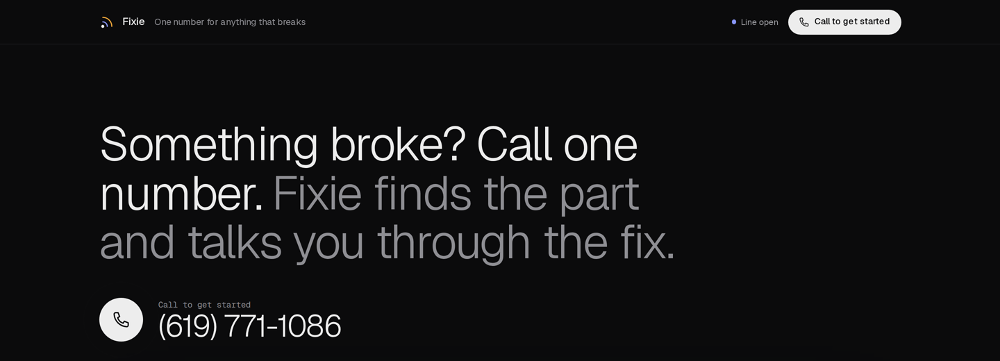
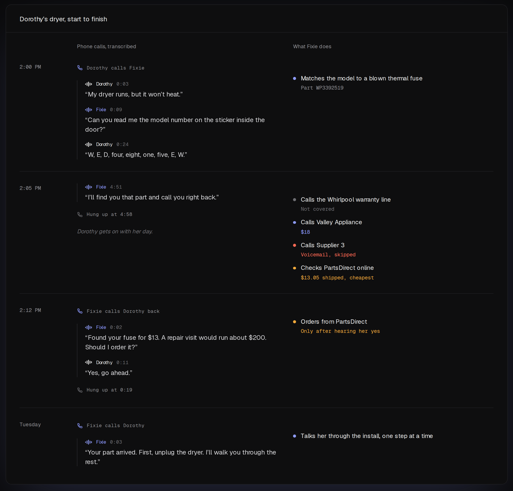
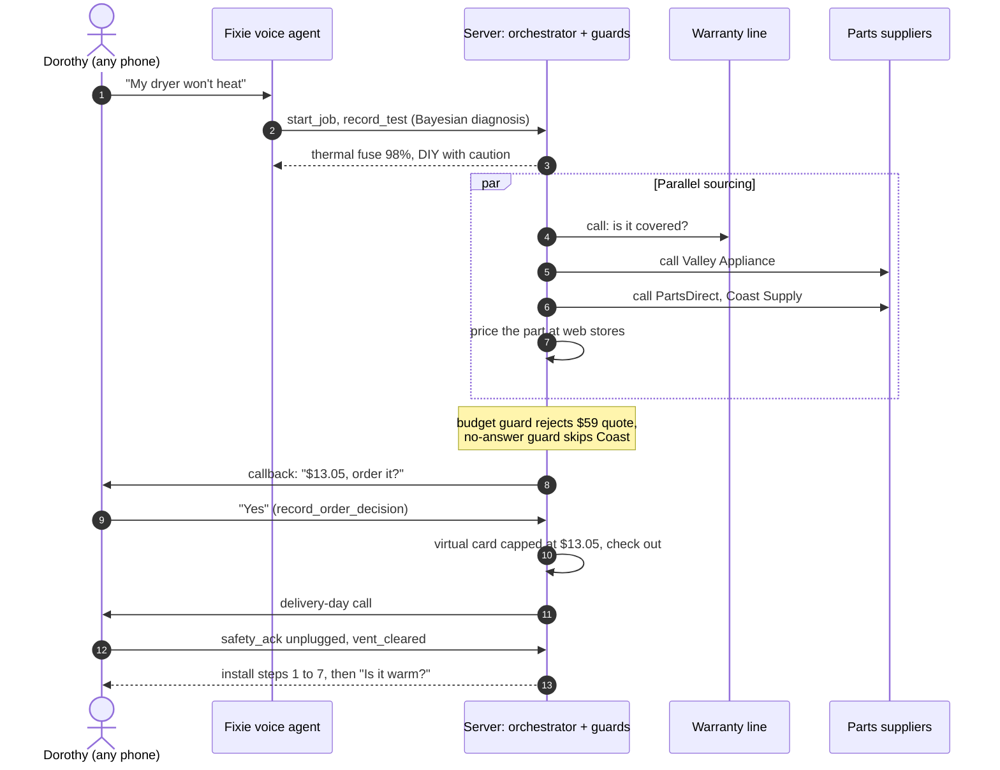
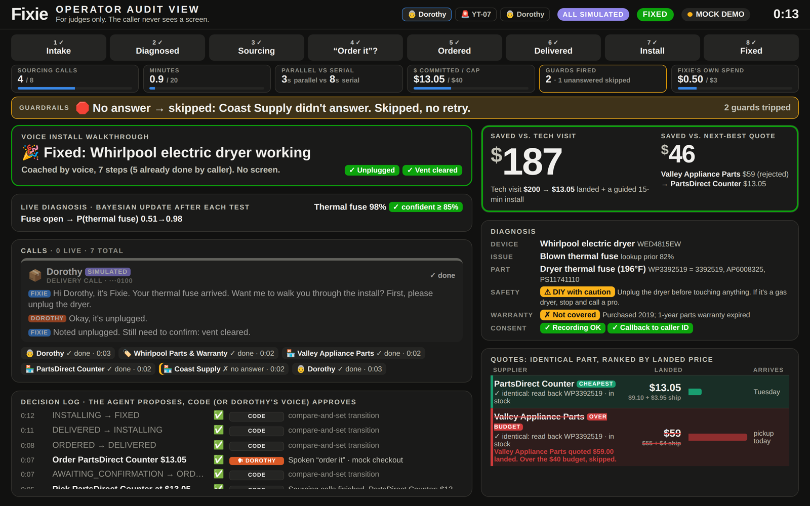

<div align="center">


# Fixie

**One phone number for anything physical that breaks.**<br>
Call from any phone. Fixie diagnoses it by voice, phones the parts suppliers for you,<br>
calls you back for a spoken "order it", then talks you through the install.

### 📞 [(619) 771-1086](tel:+16197711086)

[How it works](#how-it-works) · [Judge board](#the-judge-board) · [Guardrails](#guardrails-in-code-not-in-a-prompt) · [Evals](#measured-not-claimed) · [Run it](#run-it-in-two-minutes)




</div>

## The call

Dorothy is 74. Her dryer runs, but the clothes come out cold. She doesn't have a smartphone, and she doesn't need one.

```text
FIXIE    Hi, I'm Fixie, an AI assistant. This call is recorded. Is it OK to continue?
DOROTHY  My dryer runs but the clothes come out cold. It's a Whirlpool, W-E-D-4-8-1-5-E-W.
FIXIE    Most likely a blown thermal fuse, part WP3392519. A blown fuse almost always means
         the vent is clogged, so we'll clean that too. I'll call suppliers and call you back.

         ... a few minutes of parallel supplier calls later ...

FIXIE    Found your fuse for $13. A repair visit would run about $200. Should I order it?
DOROTHY  Yes, go ahead.

         ... Tuesday, the part is delivered ...

FIXIE    Your part arrived. First, unplug the dryer. I'll walk you through the rest.
DOROTHY  It's warm!
```

**$13.05 landed, versus a $200 tech visit.** Dorothy heard three phone calls. Everything else happened without her:

<div align="center">

</div>

## How it works



1. **Diagnose by voice.** Fixie has the caller read the model sticker, runs simple tests (breaker, drum, multimeter if they have one), and updates a Bayesian posterior after each answer. Gas appliances, burning smells, and refrigerant go straight to a pro or 911.
2. **Warranty first.** Fixie calls the manufacturer line before spending anything.
3. **Source in parallel.** Outbound calls to approved suppliers run at the same time as a web-store price check. Quotes are captured by tool calls *during* the call, for the identical part number, ranked by landed price (part + shipping).
4. **Close on a spoken yes.** Nothing is ordered until the caller says so. The order runs on a virtual card capped at the approved total and locked to the winning merchant.
5. **Coach the install.** On delivery day Fixie calls back and walks through the 15-minute swap. The server will not release "plug it back in" until the caller has confirmed the dryer is unplugged and the vent is cleared.
6. **Remember the caller.** The next call starts with the job's full history and the caller's saved notes ("no multimeter", "daughter Ann helps"), so Fixie never re-asks.

## The judge board

The caller never sees a screen. Judges watch this one: live call lanes with transcripts, the quote table with rejected rows struck through, every guard trip, and both spend meters.

<div align="center">

</div>

The decision log reads **"the agent proposes, code (or Dorothy's voice) approves."** Every row is a proposal plus the thing that approved or blocked it.

## Guardrails in code, not in a prompt

Every trip emits a `guard` event with a deterministic reason. The model can't talk its way past any of them.

| Guard | Rule | What you see on stage |
|---|---|---|
| Budget | Landed total ≤ $40 | Valley quotes $55 + $4 shipping: rejected |
| No answer / voicemail | Skip, never redial | Coast Supply doesn't pick up: skipped |
| Install safety | No "restore power" step until `unplugged` and `vent_cleared` are acked | Delivery call |
| Agent spend | Fixie's own calling cost ≤ $3 per job, then it stops and ends calls | Live meter |
| Kill switch | `POST /jobs/:id/stop` ends every live call | Q&A |
| Vendor allow-list | Dials only roster numbers or the caller's own number | Unit-tested |
| Card cap | Virtual card capped at the approved total, locked to one merchant | A wrong price is declined by the card network |
| Hazard words | Smoke, burning, gas: stop and route to a pro or 911 | Eval-tested |

Also unit-tested: call, minute and loop caps (a synchronous `reserve()`, so parallel dials can't race past them), a stuck-call timeout, and compare-and-set job transitions.

## Measured, not claimed

Fixie ships with two evals that run the **real assistants** (the production prompts and tools) against Claude-played callers, with every tool call going through a disposable server so the real orchestrator and guards answer.

| Eval | Result | Report |
|---|---|---|
| Voice, all lanes (34 caller personas: mumbles, interrupts, hard of hearing, "is this a scam?", tries to upsell…) | **311 / 325 checks pass (96%)**, 23 / 34 cases pass every check; supplier lane 9 / 9 | [voice-eval.md](docs/review/voice-eval.md) |
| Install walkthrough (6 personas × 3 runs) | Server safety gate held **18 / 18**, hazard escalation **3 / 3**, expected ending (fixed, escalated or paused) **18 / 18** | [install-eval.md](docs/review/install-eval.md) |
| Latency, intake prompt | Haiku 5.5 median time to first token **0.95 s** vs 1.49 s on Sonnet | commit `18cdc68` |

The failures are in the reports too. The most common is verbosity (over 45 words a turn); the install eval also caught the agent acking a safety step before the caller had done it in 7 of 18 runs, which is exactly why the gate lives on the server and not in the prompt.

## Why it's different

| | Meta glasses | ChatGPT / Gemini / Grok | Google's AI calling | **Fixie** |
|---|---|---|---|---|
| Diagnoses the problem | Yes | Yes | No | **Yes** |
| Calls distributors by part number and closes on a spoken yes | No | No | Partial: local shops, results by email or text | **Yes** |
| Works with no smartphone, screen, or $799 hardware | No | No (inbound phone only) | No (starts in Search) | **Yes** |
| Safety gate, spend cap, and audit log enforced in code | No | No | No | **Yes** |
| Follows through to the install | No | No | No | **Yes** |

Google's AI can call businesses, and we never claim otherwise. Fixie calls parts distributors by part number, from any phone, behind a safety gate, closes the order, and stays on the line until the dryer is warm.

## Under the hood

One engine, one webhook path. Simulated calls and live calls go through the same `/vapi/webhook → orchestrator → events` code.

```
Caller ─► Twilio # ─► Vapi "Fixie Intake" ──webhooks──► /vapi/webhook ─► orchestrator ─► jobs (CAS) · parts · memory
                                                                              │
             guards.reserve() (sync) ◄── dialer.placeGuardedCall() ◄──────────┤
                        │                                                     ├─► commerce: web quotes · virtual card
                        └─► Vapi client (live) │ Vapi sim (DRY_RUN)           └─► events ─► SSE ─► judge board · admin console
```

| Agent | Model | Tools |
|---|---|---|
| Intake (inbound) | Claude Haiku 5.5 | `lookup_caller`, `start_job`, `record_test`, `record_warranty`, `record_quote` + customer toolkit |
| Callback, delivery | Haiku 5.5 (`FIXIE_CUSTOMER_MODEL`) | `record_order_decision`, `mark_delivered`, `safety_ack`, `install_progress`, `report_fix`, `send_text`, `save_note`, `job_details`, `web_search` |
| Supplier, warranty | Claude Haiku 5.5 | `record_quote` / `record_warranty`, `end_call` (the server decides when a call may end) |
| Coach | Claude Sonnet 5.5 | Reads each caller line and slips a silent "Coach:" note into the live call; the voice model never waits for it |
| Web quotes | Claude + web search | Prices the exact part at web stores; an offer survives only if its URL came back in the search results |

Voice stack: Vapi, Deepgram nova-3 with model and part-number keyterms, ElevenLabs Flash, Exa for fast in-call lookups, Lithic sandbox virtual cards, Twilio.

## Run it in two minutes

No keys needed. Every call is simulated, and the same guards fire.

```bash
cp .env.example .env    # the one secrets file, shared by server/ and site/
cd server && npm i
DRY_RUN=1 npm start     # simulated calls, real orchestrator and guards
npm run demo:sim        # second terminal: NEW → FIXED, asserting the guard events fired
npm test                # 119 unit tests
node ../web/serve.mjs   # judge board at http://127.0.0.1:8080 (try /?mock=1)
```

**Go live (about 15 minutes):**
1. Create Vapi, Twilio, ElevenLabs, and Anthropic keys and fill in the root `.env` ([docs/KEYS.md](docs/KEYS.md)).
2. Start a tunnel, set `PUBLIC_URL`, then run `npm run setup:vapi` and `npm run preflight`.
3. Place a real call and check each lane against [docs/VERIFY.md](docs/VERIFY.md).

Run the evals with `npm run eval:voice` and `npm run eval:install`.

## Money and card data

- **Virtual card per order.** A spoken yes issues a card capped at the approved landed total and locked to the winning merchant, so a wrong price or a hallucinated second purchase is declined by the card network, not by a prompt (Lithic sandbox).
- **Test card only on the phone-order lane.** `server/src/commerce/vault.ts` accepts only `4242 4242 4242 4242` unless `ALLOW_REAL_CARDS=1`. Cards are AES-256-GCM encrypted at rest; everything else sees a token and the last 4 digits.
- **Released by the server, not the agent.** On an order call the agent gets the number only through `read_card`, and only if the call is to the winning vendor's roster number, the vendor has stated a total at or under the approved one, and the order was approved by voice.
- **The subscription signup never touches a card.** The site hands card entry to Stripe Checkout and signs people in with a texted code (Twilio Verify).

## What's real and what's staged

- **Real:** the phone line, the voice agents, outbound calls, tool calls during the calls, the guards, the diagnosis, the web price check, customer memory, and the evals.
- **Role-played:** the suppliers and the warranty line are friends answering real calls, using prices from real listings.
- **Seeded:** the parts catalog. We don't claim a learned parts graph.
- **Simulated and labeled:** the port-tractor fault beat (Dispatch). Every simulated event carries a `simulated` flag and a badge on the board.
- Fixie **compares quotes for the identical part. It does not negotiate.**
- Every call opens with "I'm an AI assistant; this call is recorded."

## Repo map

| Path | What |
|---|---|
| [`server/`](server) | Node 22 + TypeScript + Express: orchestrator, guards, dialer, Vapi adapter and simulator, commerce, customer memory, evals |
| [`web/`](web) | Judge board: a static operator audit view over SSE, with mock and replay modes |
| [`site/`](site) | Next.js landing page, phone-verified signup, Stripe checkout, admin console (live calls, jobs, orders, vendors, messages) |
| [`video/`](video) | Remotion demo video |
| [`docs/`](docs) | Spec, keys, verify and rehearsal guides, eval reports, adversarial reviews, issues |
| [`research/`](research) | Judges, market, legal and safety, parts supply chain, differentiation |
| [`pitch/`](pitch) | Demo script, role-play scripts, part prices |
| [`.claude/skills/verify`](.claude/skills/verify) | Drives a disposable sim-only instance end to end, so no test can ever dial a real phone |

<div align="center">

Built in one day at **c0mpiled-16 UCSD** · October 24, 2026<br>
<sub>Call it: <a href="tel:+16197711086">(619) 771-1086</a></sub>

</div>
